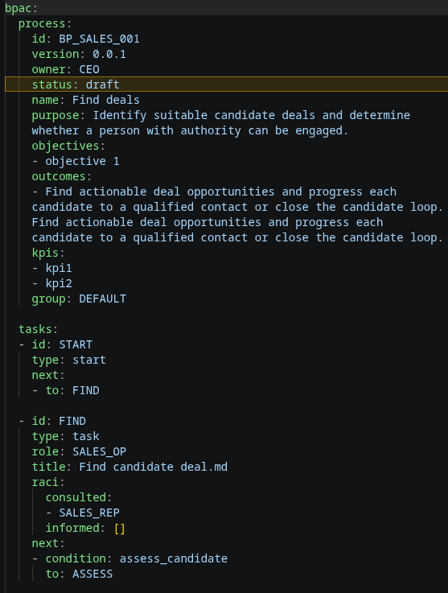
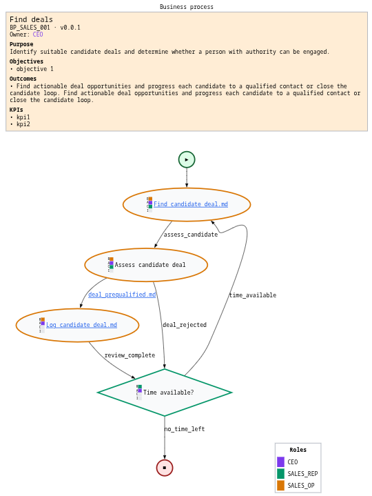
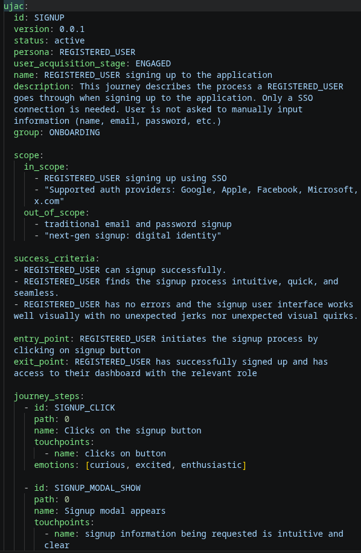
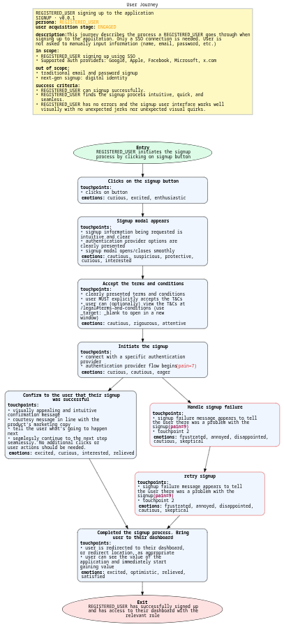
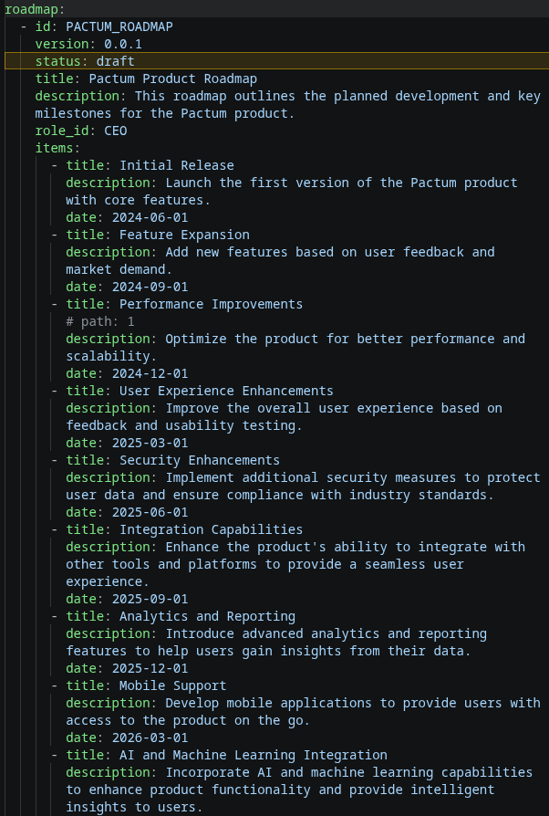
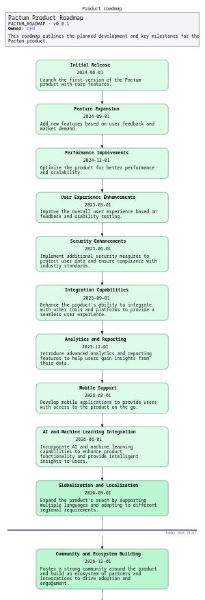
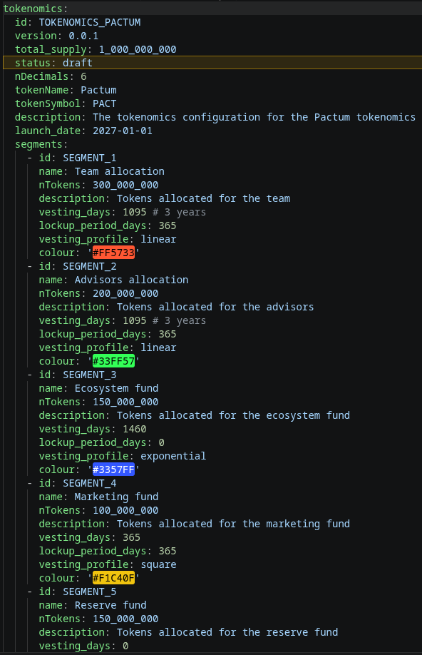
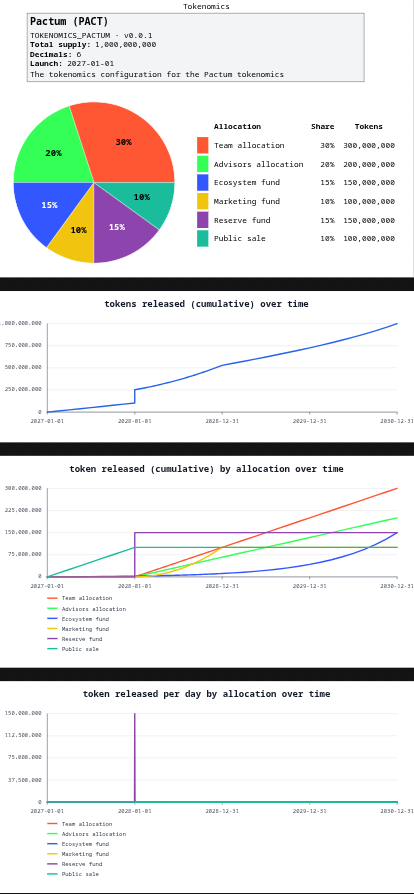

# SPUD

**S**pec-driven **P**roduct **U**X & **D**omain logic (SPUD).

A VS Code extension. Search for "spud".

Opinionated user-journey-as-code and business-process-as-code guide rails (with write-time validation) for product designers in the AI era.

Problem: people set out to build a product without having fully thought through **what** they want to build. When there is ambiguity on **what** to build, many development iterations are burned as you figure-it-out-as-you-go.

Solution: SPUD is a specification-first approach to product development that guides you (in an opinionated way) to create user journey and business process flows *up-front*; thereby making it easier for an AI to know **what** you want and build more effectively.

SPUD enables you to quickly generate flow diagrams that are both human (.svg files) and machine -readable (.dot files). Machine-readable product and business specifications can be used to more effectively guide an AI agent towards building a well-specified product. 

SPUD's approach reduces iteration cycles and reduces the time it takes to build an end-to-end product while forcing you, a human, to *think up-front* and articulate at a high level **what** you're building *prior* to any implementation.


## Feature requests

If you encounter an issue or want to see a feature, simply open an issue here on github. We'd love to hear from you.


## Screenshots

A picture paints a thousand words...

Business process (yaml):



Auto-rendered business process (dot diagram):



User journey (yaml):



Auto-rendered user journey (dot diagram):



Roadmap (yaml):



Auto-rendered roadmap (dot diagram):



Tokenomics (yaml):



Auto-rendered tokenomics (dot diagram):




## Recommended accompanying VScode extensions:

- Redhat yaml extension
- Error Lens (usernamehw.errorlens)

--------------------

## Types of processes:

1. business-process-as-code
2. user-journey-as-code
3. product-roadmap-as-code
4. tokenomics-as-code


## 1. business-process-as-code

Business processes are written in .yaml

### PBAC Validator

BPAC is a minimalist, opinionated user journey format.

A business process is written in yaml (the top level key in the .yaml file should be "bpac") and is designed to be written by and read by non-expert humans, while simultaneously being easily interpreted by a machine.

This is a VS Code extension for validating Business-Process-As-Code (BPAC) YAML files.

BPAC will render your .yaml and produce business process flowcharts that you can use to define, articulate, organise, commmunicate around and operate your business.


## Usage

1. Open a `.yaml` that conforms to the bpac format
3. Run the command `bpac: Validate current file` or let the extension validate automatically on save.


It then highlights any matching problems directly in the active document.

Highly recommended: Error Lens extension

### Next destinations

BPAC start, task, and decision nodes accept a single destination ID or an array
of destination IDs. Each destination must match a task `id` in the same process:

```yaml
next: ASSESS
```

```yaml
next: [FIND, END]
```

The existing array of `{to, condition}` objects remains supported for labelled
arrows, and may be mixed with plain IDs:

```yaml
next:
  - FIND
  - to: END
    condition: no_time_left
```

BPAC draws only the explicitly listed outgoing connections. End tasks still
must not contain `next`. UJAC steps also accept a single ID or an array of IDs;
their explicit `next` destinations replace automatically generated outgoing
connections.

### Business process overview

Saving a BPAC process or its sibling configuration generates `out/groups.dot`
and `out/groups.svg` with a **Business processes** header. All sibling BPAC
processes (`.yaml` and `.yml`) appear as ellipses labelled with filename, process
ID, and name, enclosed by their configured coloured groups.

Define optional groups in `bpac.config.groups` in `config.yaml` or `config.yml`:

```yaml
bpac:
  config:
    groups:
      - id: DEFAULT
        name: Default group
        description: General business processes
        color: '#aaffaa'
      - id: SALES
        name: Sales
        description: Sales processes
        color: '#aaddff'
```

Assign a process using `bpac.process.group: DEFAULT.SALES`. Each segment must
match a configured group ID; duplicate configured IDs are rejected. Omit the
field to show the process in a neutral **Ungrouped** ellipse (no implicit
default). Only populated groups and their ancestors are shown. Nested groups
use the same compact, non-overlapping layout as user journeys, implemented in
the shared renderer.

The blue filename opens the source YAML; the rest of its ellipse opens the
individual process SVG. The basename `groups` is reserved for the overview.
Invalid sibling YAML and invalid group configuration/references are reported
as rendering errors. Graphviz must be installed. To regenerate the SVG from
its positioned DOT file, use:

```sh
dot -Kneato -n2 -Tsvg out/groups.dot -o out/groups.svg
```

Rendering regression tests:

```sh
npm run compile && node --test tests/bpac-groups.test.js tests/ujac-groups.test.js tests/output-status.test.js tests/status-validation.test.js tests/paths.test.js tests/editor-decorations.test.js
```

## Rules

- validates task structure by task type
- requires all-caps task ids
- requires all-caps `next.to` targets
- rejects extra keys on `next` objects
- rejects `next` on `end` tasks
- verifies that each `next.to` references an existing task id

## event bus (NATS) integration

Every time a transition to the next task in bpac.tasks:[task] occurs, an event can be fired on NATS. This is a powerful approach for linking your biz process into your organization.

For example, BP_TASK emits with value "BP_SALES_001.ASSESS->IS_TIME_AVAIL"

This reads "A biz process task emits an event. The bp with id BP_SALES_001 transitioned from task.id=ASSESS to task.id=TIME_AVAIL

This is a very powerful approach and allows for:
- logging and auditing of all bp transitions
- isolation and decoupling of tasks
- event-driven architecture
- durable workflows (e.g. temporal.io)
- retry capability

*Note: ensure NATS has Jetstream enabled for persistence*

*Note: ensure all calls are idempotent. This facilitates retries and the saga pattern.*


------------------------------

## 2. user-journey-as-code

User journeys are written in .yaml

### UJAC Validator

UJAC is a minimalist, opinionated user journey format.

A user journey is written in yaml (the top level key in the .yaml file should be "ujac") and is designed to be written by and read by non-expert humans, while simultaneously being easily interpreted by a machine.

This is a VS Code extension for validating User-Journey-As-Code (UJAC) YAML files.

UJAC will render your .yaml and produce business process user journey charts that you can use to define, articulate, organise, commmunicate around and operate your business.

Unlike a BP, a user journey is **outward looking**. A user journey is more wordy and loosely described, whereas a business process is more well-defined and specific.

## Usage

1. Open a `.yaml` that conforms to the ujac format
2. Run the command `pac-validator: Validate current file` or let the extension validate automatically on save.


It then highlights any matching problems directly in the active document.

Highly recommended: Error Lens VScode extension

### Configuration groups

`ujac.config.groups` is an optional array in the configuration document. It may
be omitted or set to `[]`. Each group requires a unique ALL-CAPS `id` (letters,
digits, and underscores), a non-empty, non-whitespace `name` and `description`,
and a six-digit RGB hex `color` (`#RRGGBB`). Unknown group fields are rejected.

```yaml
ujac:
  config:
    user_acquisition_stages: []
    personas: []
    groups:
      - id: DEFAULT
        name: Default group
        description: General user journeys
        color: '#aaffaa'
```

An explicit journey `ujac.group` is a group ID or a dot-separated path from
the outermost group to the innermost subgroup, such as:

```yaml
ujac:
  # Other journey fields omitted
  id: BROWSE_WEB3
  group: DEFAULT.SUB_GROUP
```

This journey belongs to `SUB_GROUP` inside `DEFAULT`. Define both `DEFAULT`
and `SUB_GROUP` as separate entries in `ujac.config.groups`; configuration IDs
remain simple IDs, not dotted paths. Deeper nesting, such as
`DEFAULT.SUB_GROUP.LEAF`, is supported. Nesting is defined by the journey path;
the same configured group may appear under different parents as separate
instances in the overview.

Every path segment must match a group `id` in the sibling
`config.yaml`. Unknown IDs are highlighted at the group value, including when
groups are empty, omitted, or no configuration exists. The group is optional;
omitting it retains the schema's `DEFAULT` annotation without inserting or
validating an implicit value.

### Alternate paths in a journey

In `ujac.journey_steps`, omit `path` or set it to `0` for a step on the main
journey. Use a positive integer for an alternate branch. Consecutive steps with
the same positive value make up that branch. The branch replaces the immediately
preceding happy-path step, forks from the happy-path step before it (or the
overview), and rejoins at the next happy-path step. For example, the journey
below keeps `FIRST_IMPRESSION` on the main path and provides an alternate route
through `COMPARE_OPTIONS` and `REVIEW_DETAILS` before `UNDERSTAND`:

```yaml
ujac:
  journey_steps:
    - id: AWARENESS
      name: Become aware
      touchpoints: []
      emotions: []
    - id: FIRST_IMPRESSION
      name: Form a first impression
      touchpoints: []
      emotions: []
    - id: COMPARE_OPTIONS
      name: Compare options
      path: 1
      touchpoints: []
      emotions: []
    - id: REVIEW_DETAILS
      name: Review details
      path: 1
      touchpoints: []
      emotions: []
    - id: UNDERSTAND
      name: Understand the offer
      path: 0
      touchpoints: []
      emotions: []
```

Here, `path: 0` is equivalent to omitting `path`. A different positive value,
such as `path: 2`, identifies a separate alternate lane farther to the right;
it does not mean “the second step” or make a branch continue from path `1`.

Any UJAC journey step may also have an optional `next` field containing either
one step `id` or an array of step IDs from the same `journey_steps` list. When
`next` is set, it overrides that step's automatically generated outgoing
connections; list any automatic target you want to retain alongside other
destinations. Each target must match an existing step ID:

```yaml
  journey_steps:
    - id: LOGIN_OPEN
      name: Open the login modal
      touchpoints: []
      emotions: []
    - id: LOGIN_RETRY
      name: Guide the user to try again
      next: [LOGIN_OPEN, LOGIN_SUPPORT]
      touchpoints: []
      emotions: []
    - id: LOGIN_SUPPORT
      name: Contact support
      touchpoints: []
      emotions: []
```

### Business processes supporting journey steps

Each journey step accepts an optional `supporting_bps` array of unique business process
IDs (uppercase letters, digits, and underscores). Omit it or use `supporting_bps: []` when
no processes are linked:

```yaml
  journey_steps:
    - id: LOGIN_INITIATE
      name: Initiate SSO login
      supporting_bps: [AUTH]
      touchpoints: []
      emotions: []
```

Each ID must match `bpac.process.id` declared in a `.yaml` or `.yml` file
directly inside the adjacent `../bps/` directory. For example,
`resources/ujs/login.yaml` can reference `AUTH` declared in
`resources/bps/auth.yaml`; the filename does not have to match the ID.
Configuration IDs, task IDs, and processes in other directories do not count.
Unknown references are highlighted individually in the journey. Unreadable or
malformed process files are reported at `supporting_bps`, rather than silently ignored.

Validation uses unsaved contents of open process files and refreshes open
journeys when adjacent process files are opened, edited, saved, closed, created,
or deleted. These links do not change the journey's diagram connections.

### System journey overview

Journey `ujac.id` values must be unique across sibling journey YAML files.
Duplicates are reported at the ID in each affected open document and identify
the conflicting filenames. Validation includes unsaved edits in open documents
and refreshes when sibling files are edited, created, or deleted.

Saving a `ujac:` journey or its sibling configuration regenerates
`out/groups.dot` and `out/groups.svg` from all journey `.yaml` and `.yml` files
in that directory, with a **User journeys** header. Each journey is an ellipse labelled with its filename,
`ujac.id` (when present), and name, nested inside a larger ellipse using its
configured group's name and
color. Dotted group paths produce nested subgroup ellipses, with each journey
drawn once inside its innermost group and enclosed by all its ancestors. Direct
members and subgroups share their parent's space without overlapping. Rows use
each member's actual dimensions, and group ellipses fit their contents with
compact padding rather than reserving subgroup-sized cells for every journey. Only
groups with journeys or populated descendants are shown. Journeys without an explicit group
appear in a neutral **Ungrouped** ellipse; no implicit `DEFAULT` is inserted.
The blue, underlined filename links to its source YAML. Click the rest of the
journey ellipse in the SVG to open its individual diagram.

The overview uses positioned Graphviz ellipses rather than rectangular clusters.
Render it manually with `dot -Kneato -n2 -Tsvg out/groups.dot -o out/groups.svg`.
The basename `groups` is reserved for the overview. Invalid sibling YAML or
unknown group references are reported as rendering errors.

## Features

- validates task structure by task type
- requires all-caps task ids
- requires all-caps `next.to` targets
- rejects extra keys on `next` objects
- rejects `next` on `end` tasks
- verifies that each `next.to` references an existing task id


-----------------------------

## 3. product-roadmap-as-code

Specify a product roadmap in .yaml file format.

root key of the `.yaml` file should be: `roadmap:`

The root value is one roadmap object with an `items` array. The bundled
`resources/roadmap.schema.json` is registered automatically for YAML files with
a root `roadmap:` key. Each roadmap accepts only `id`, `version`, `status`, `title`,
`description`, `role_id`, and `items` keys; unknown keys are rejected.
Legacy arrays of roadmaps are still supported, but all entries must have the
same status because they share one rendered file.

```yaml
roadmap:
  id: PRODUCT_ROADMAP
  version: 0.0.1
  status: draft
  title: Product roadmap
  items:
    - title: Initial release
      description: Launch core features
      date: '2027-01-01'
```

Each item accepts only the following fields:

| Field | Required | Constraint |
|---|---|---|
| `title` | Yes | String, at most 255 characters |
| `description` | Yes | String, at most 2047 characters |
| `date` | Yes | Valid calendar date in `YYYY-MM-DD` format |
| `group` | No | Non-negative number, default `0` |
| `path` | No | Non-negative integer, default `0` |

The `group` and `path` defaults are JSON Schema annotations; validation does not
insert them into the YAML document. Consumers should treat an omitted `group` or
`path` as `0`.

`path: 0` (or an omitted `path`) keeps an item on the main roadmap. A positive
integer marks an alternate branch: consecutive items with the same positive
value form one branch, replacing the preceding happy-path item and rejoining at
the next happy-path item. Higher values appear in lanes farther to the right.
For example, these alternate milestones form path `1` between the two main-path
items:

```yaml
roadmap:
  items:
    - title: Define the approach
      description: Agree on the main direction.
      date: '2027-01-01'
    - title: Build the initial option
      description: Continue along the main roadmap.
      date: '2027-02-01'
      # path: 0 # optional - default is 0
    - title: Evaluate an alternative
      description: Explore a different implementation.
      date: '2027-02-15'
      path: 1
    - title: Validate the alternative
      description: Check the alternate implementation.
      date: '2027-03-01'
      path: 1
    - title: Launch
      description: Deliver the selected outcome.
      date: '2027-04-01'
      path: 0
```

The main route continues through **Build the initial option** to **Launch**.
Path `1` branches from **Define the approach** and rejoins at **Launch**. Use
`path: 2` for another alternate lane at that position; path numbers can be
sparse and do not have to form a sequence.

Groups and roles are configured in a sibling `config.yml` (or `config.yaml`):

```yaml
roadmap:
  config:
    groups:
    - id: 0               # number, matched against item `group`
      name: Default Group # string
      color: '#2563EB'    # #RRGGBB
    roles:
    - role: CEO           # ALL CAPS
      color: '#7C3AED'    # #RRGGBB
```

Roadmap documents also pass through `src/roadmap/semanticConstraints.ts` when
opened, edited, or saved. It checks that roadmap ids are unique in the folder
and, when a config file exists, that each `role_id` is one of
`roadmap.config.roles[].role`.

On save, each roadmap is rendered to `<output-directory>/<file>.dot` and
`<output-directory>/<file>.svg`, using the status directories described above,
next to the `.yaml`: a grey overview box (title, id/version, owner in its role
color, description) followed by the items connected top to bottom. Each item is
filled with its group's color (group `0` when omitted). A grey "today" line is
drawn wherever a past item is followed by a future one. As with BPAC and
UJAC, any string ending in `.md` becomes a link and an empty
`docs/<ROADMAP_ID>.<name>.md` is created if missing.


## 4. tokenomics-as-code

Specify the tokenomics of your token in .yaml file fomat.

The root key of your `.yaml` file should be `tokenomics:`

The required `version` field is a SemVer 2.0.0 string, such as `0.0.0` or
`1.2.3-rc.1+build.42`, matching the version convention in the other formats.

Positive `total_supply` and `nTokens` values may use underscores as digit
separators (for example, `1_000_000_000`).

On save (and when the extension starts with the document open), Graphviz renders
the segments as a pie chart to `out/<file>.svg` beside the source YAML. No `.dot`
file is written: the chart definition is passed directly to Graphviz. Each slice
uses its segment's `colour` and its `nTokens / total_supply` share; the legend
shows segment names, percentages, and token amounts. Percentages are also drawn
halfway around each slice at 62% of the pie radius, with black or white text
chosen for contrast. A single allocation has its `100%` label at the centre.
Graphviz lays out the chart; the renderer overlays these labels in the SVG.

Below the pie chart, the SVG includes a line chart titled "tokens released
(cumulative) over time". Its x-axis runs from `launch_date` through the longest
segment schedule (`lockup_period_days + vesting_days`); its y-axis shows
cumulative released tokens. Tokens remain locked until the lockup ends, then
vest over `vesting_days` according to its optional `vesting_profile` (default:
`linear`). Supported profiles are `linear`, `square` (`t²`), `hyperbolic`
(`t / (1 + 5(1 − t))`), and `exponential` (`(e^(5t) − 1) / (e^5 − 1)`),
where `t` is the elapsed fraction of the vesting duration. A segment with zero
vesting duration is released in full when its lockup ends.

Below that, a second line chart titled "token released (cumulative) by allocation
over time" shows one color-coded cumulative release curve for each segment, with
an allocation legend. Its y-axis maximum is the largest segment's `nTokens`, not
`total_supply`.

A third line chart titled "token released per day by allocation over time" shows
the tokens released each day for each segment, with the same allocation colors
and a legend. Its y-axis is scaled to the highest daily release across all
segments. All three line charts have white backgrounds.

A grey overview box above the chart shows the token name/symbol, id and
`v<version>`, total supply, decimals, launch date, and description. Total supply
and decimals appear on separate lines, matching the other diagram
conventions. Markdown descriptions link to sibling `docs` files as in the other
renderers. Rendering reports an error for empty segments, duplicate segment ids,
invalid amounts/durations/colours or dates, or allocations that do not sum to
`total_supply`.

Run the rendering regression tests with Graphviz installed:

```bash
npm run compile && node --test tests/tokenomics.test.js
```

## vesting_profile

Let (t) be the elapsed fraction of the vesting period, clamped to ([0,1]). The released fraction is:

```latex
Linear: (f(t)=t)
Square: (f(t)=t^2)
Hyperbolic: (f(t)=\dfrac{t}{1+5(1-t)})
Exponential: (f(t)=\dfrac{e^{5t}-1}{e^5-1})

For an allocation of (N) tokens, the amount released is (Nf(t))
```


